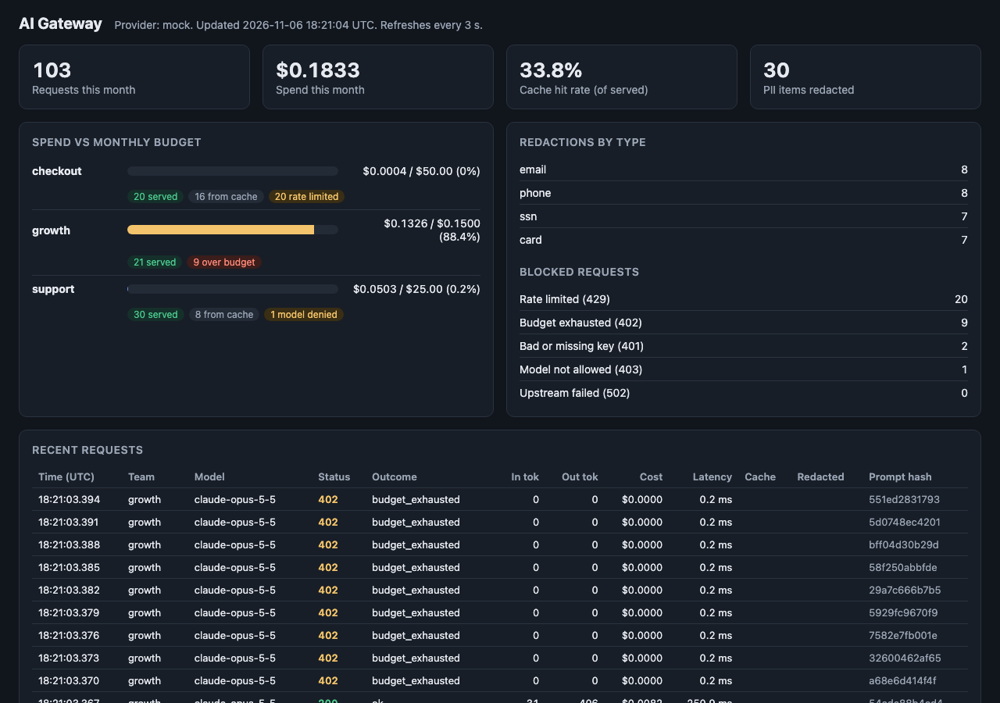

# AI Gateway

A FastAPI service that sits between a company's internal apps and the Claude API. Apps send a normal Claude Messages request to `POST /v1/messages` with a per-team gateway key. The gateway checks the key, the model allowlist, the team's rate limit, and its monthly budget, strips PII from the prompt, serves repeats from a cache, calls Claude with retries and a fallback model, and writes every request to an append-only audit log. An admin dashboard shows spend by team against budget, blocked requests, cache hit rate, and redactions. It runs offline with a deterministic mock upstream by default.



## Why

Once a dozen teams call an LLM API directly, a platform team loses track of who spends what, which prompts carry customer data out of the network, and why the bill jumped. The usual fix is a gateway: one place that owns the API key, enforces per-team quotas and budgets, redacts PII, caches, retries, and logs. This repo is a small working version of that pattern, with each policy as a small function that is tested on its own.

## Architecture

```
 internal app ──POST /v1/messages──▶ ┌──────────────────────── AI Gateway ────────────────────────┐
   x-gateway-key: gw-...             │ 1 auth (key → team)                         401             │
                                     │ 2 model allowlist                           403             │
                                     │ 3 token-bucket rate limit (per team)        429 Retry-After │
                                     │ 4 PII redaction (email, phone, SSN, card)                   │
                                     │ 5 exact-match cache (sha256 of request) ──▶ hit: cost $0    │
                                     │ 6 budget check (month spend + estimate)     402             │
                                     │ 7 upstream call, retry 429/5xx with         502 if all fail │
                                     │   backoff + jitter, then fallback model                     │
                                     │ 8 audit log (SQLite, append-only) + metrics                 │
                                     └───────────┬──────────────────────────────┬─────────────────┘
                                                 │                              │
                                     Provider interface               /metrics  /admin/usage  /
                                     mock (default) | anthropic       Prometheus  JSON   dashboard
```

| Piece | File |
|---|---|
| Teams, keys, budgets, limits, allowed models | `config/gateway.yaml` (synthetic keys) |
| Policy steps: auth, allowlist, token bucket, budget, redaction wrapper, cache | `src/aigateway/policies.py` |
| PII patterns and Luhn check | `src/aigateway/pii.py` |
| Price table: Opus 5.5 $4/$20, Sonnet 5.5 $2/$10, Haiku 5.5 $0.10/$0.50 per million tokens | `src/aigateway/pricing.py` |
| Mock and Anthropic providers, retry with full jitter, fallback | `src/aigateway/providers.py` |
| Audit log with triggers that block UPDATE and DELETE | `src/aigateway/audit.py` |
| Prometheus text output, no client library | `src/aigateway/metrics.py` |
| Endpoints and pipeline wiring | `src/aigateway/app.py` |
| Dashboard (one HTML file, plain JS) | `src/aigateway/static/index.html` |

Details worth knowing:

- **Budget** is checked before the call with a worst-case estimate (input chars / 4 plus the full `max_tokens` of output at the model's price), and the actual cost from the upstream `usage` is recorded after. Month spend is summed from the audit log, so it survives restarts.
- **Rate limit** is a token bucket per team: capacity equals the requests-per-minute limit, refilled continuously. A 429 carries `Retry-After` in whole seconds.
- **Redaction** runs before the cache key is computed and before anything leaves. Card numbers are only redacted if they pass a Luhn check, so order numbers are left alone.
- **Cache** keys are `team + sha256(normalized request)`: key order and surrounding whitespace do not matter, and teams never share entries. Cache hits cost $0 and skip the budget check.
- **Audit log** stores team, model, tokens, cost, latency, cache hit, redaction counts by type, status, and a sha256 of the request. It never stores prompt text.
- **Errors** use the Anthropic error shape: `{"type": "error", "error": {"type": "rate_limit_error", "message": "..."}}`.
- **Response headers**: `x-request-id`, `x-gateway-cache`, `x-gateway-cost-usd`, `x-gateway-redactions`, `x-gateway-attempts`, and `x-gateway-fallback` when the fallback model answered.

## How to run

Requires [uv](https://docs.astral.sh/uv/). Docker is optional.

```bash
make install            # uv sync --python 3.12
make run                # gateway on http://127.0.0.1:8080, mock upstream
```

In a second terminal:

```bash
make loadgen            # synthetic traffic from three teams
open http://127.0.0.1:8080/        # dashboard
curl -s http://127.0.0.1:8080/metrics
curl -s http://127.0.0.1:8080/admin/usage
```

One request by hand:

```bash
curl -s http://127.0.0.1:8080/v1/messages \
  -H 'x-gateway-key: gw-support-91be55' -H 'content-type: application/json' \
  -d '{"model":"claude-haiku-5-5","max_tokens":200,
       "messages":[{"role":"user","content":"Reply to dana@fabrikam-mail.example about her refund"}]}'
```

The loadgen run tells three stories. On a fresh audit log it produces:

| Team | Setup | 200 | 402 | 403 | 429 |
|---|---|---|---|---|---|
| checkout | 40 burst requests at 20 per minute | 20 (16 from cache) | 0 | 0 | 20 |
| growth | Opus, `max_tokens` 1024, $0.15 budget | 21 | 9 | 0 | 0 |
| support | 30 prompts with emails, phones, SSNs, cards; one Opus call | 30 (8 from cache) | 0 | 1 | 0 |

Plus 2 requests with a bad or missing key (401), 30 PII items redacted, and a 33.8% cache hit rate. Budgets are monthly and read from the audit log, so run `make demo-reset` (with the server stopped) to start the story over.

To call the real Claude API, install the extra and set the key in your shell:

```bash
uv sync --extra claude
export ANTHROPIC_API_KEY=...       # see .env.example
GATEWAY_PROVIDER=anthropic make run
```

Docker (not run locally on this machine; the image is built and smoke tested in CI):

```bash
docker compose up --build                      # gateway on :8080
docker compose --profile metrics up --build    # plus Prometheus on :9090 scraping /metrics
```

## Tests

45 tests, all offline, using FastAPI's TestClient with a fake upstream, a fake clock, and a recorded sleep function.

```bash
make test     # uv run pytest -q
make lint     # ruff check and ruff format --check
```

- `test_pii.py` (7): emails, SSNs (invalid area numbers skipped), cards only when Luhn passes, three phone formats, clean text untouched, content blocks redacted without mutating input.
- `test_policies.py` (11): auth, allowlist, token bucket burst and refill, `Retry-After` value, per-team buckets, price table, budget estimate and hard stop, request hash normalization, cache TTL and LRU eviction, config validation.
- `test_providers.py` (8): mock determinism and simulated latency, backoff bounds, retry then success, no retry on 400, fallback after retries run out, Anthropic SDK response and error mapping with a fake client.
- `test_audit.py` (2): UPDATE and DELETE are rejected, month spend ignores last month.
- `test_gateway.py` (17): end to end through HTTP: response shape, request id propagation, 400, 401, 403, 429 then recovery, 402 once spend runs out, PII never reaches the upstream, raw prompts never reach the database, cache hits skip the upstream and cost $0, per-team cache, retry, fallback, 502, `/metrics` output, `/admin/usage` and the dashboard, `/healthz`.

CI (`.github/workflows/ci.yml`) runs ruff and pytest, then builds the Docker image, starts it, and sends one request through it.

## Production notes

- Rate limit buckets and the cache live in process memory. With more than one replica, move both to Redis (a Lua script for the token bucket) so limits hold across instances.
- Gateway keys sit in plain text in the config for the demo. In production, store only key hashes, issue keys through a secret manager, and add rotation and expiry. Put `/admin` behind SSO.
- SQLite with a trigger is enough to show append-only intent. At scale, ship audit events to a queue and into a warehouse or WORM object storage, and reconcile spend daily against the provider's invoice.
- Regex redaction catches structured PII only. Names, addresses, and free-text health data need an NER model or a DLP service, plus a per-team policy for block versus redact.
- Budget checks race when one team sends many requests at once. A real gateway reserves the estimate atomically, then settles the actual cost.
- Add streaming (server-sent events) passthrough, prompt caching headers, and per-team model routing rules before teams would adopt it.

## License

MIT. See [LICENSE](LICENSE).
